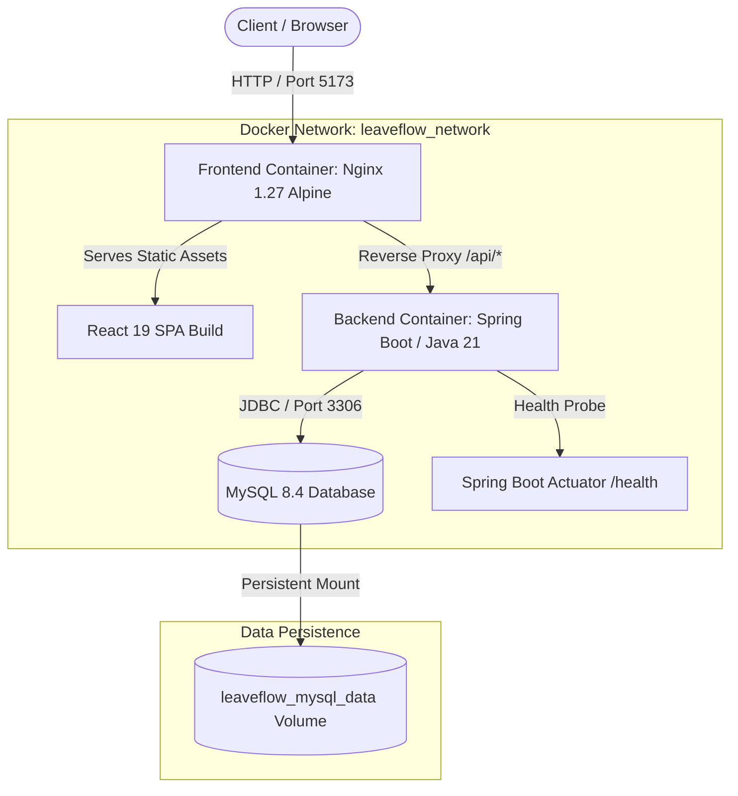

# 🌿 LeaveFlow — Enterprise Employee Leave Management System

[](https://github.com/ChaninduImanjith/employee-leave-devops/actions/workflows/backend-ci.yml)
[](https://github.com/ChaninduImanjith/employee-leave-devops/actions/workflows/frontend-ci.yml)


> A modern, full-stack, cloud-native Employee Leave Management System architected with enterprise-grade DevOps practices. Features a Spring Boot REST API, a React 19 single-page application, automated CI/CD pipelines, multi-stage Docker containerization, and role-based security.

---

## 📑 Table of Contents

- [Overview](#-overview)
- [System Architecture](#-system-architecture)
- [Key Features](#-key-features)
- [Tech Stack](#-tech-stack)
- [DevOps & CI/CD Engineering](#-devops--cicd-engineering)
- [Project Structure](#-project-structure)
- [Getting Started](#-getting-started)
  - [Prerequisites](#prerequisites)
  - [Quick Start with Docker Compose (Recommended)](#1-quick-start-with-docker-compose-recommended)
  - [Manual Local Development Setup](#2-manual-local-development-setup)
- [Configuration & Environment Variables](#-configuration--environment-variables)
- [Pre-configured Demo Accounts](#-pre-configured-demo-accounts)
- [API Documentation](#-api-documentation)
- [Testing & Quality Assurance](#-testing--quality-assurance)
- [Security Best Practices](#-security-best-practices)
- [Author & Maintenance](#-author--maintenance)

---

## 🌟 Overview

**LeaveFlow** streamlines organizational time-off management by eliminating paper-based and disjointed leave requests. Designed from the ground up for developer productivity and operational resilience, LeaveFlow packages a robust backend, responsive frontend, and containerized micro-services orchestrated with Docker Compose and GitHub Actions.

---

## 🏗 System Architecture

The following diagram demonstrates the containerized networking flow, reverse proxy routing, and data persistence layers:



### Request Flow
1. **Frontend**: Client connects to port `5173`. Nginx serves compiled React 19 static assets or routes requests.
2. **Reverse Proxy**: Requests directed to `/api/*` are reverse-proxied internally to `http://backend:8082`.
3. **Stateless Security**: Every API invocation passes through Spring Security OAuth2 Resource Server, decoding and verifying the HMAC-SHA256 JWT signature.
4. **Data Layer**: Backend interfaces with MySQL 8.4 via Spring Data JPA and Hibernate.

---

## ⚡ Key Features

### 👤 Employee Self-Service Portal
- **Leave Application**: Apply for leave by specifying date ranges, leave types, and detailed reasons.
- **Personal Leave History**: View real-time statuses (`PENDING`, `APPROVED`, `REJECTED`) for all submitted requests.
- **Account Settings**: Self-service secure password changes.

### 🛡 Administrator Suite
- **Centralized Leave Dashboard**: Inspect company-wide leave submissions with instant filtering.
- **One-Click Decisioning**: Approve or reject pending applications with real-time state updates.
- **Employee Lifecycle Management**:
  - Provision new employee accounts.
  - Update employee department and profile information.
  - Temporarily disable/enable employee logins.
  - Perform administrative password resets.

### 🔒 Enterprise Security
- **Stateless Authentication**: High-performance JWT bearer tokens issued upon login.
- **Role-Based Access Control (RBAC)**: Strict segregation between `ROLE_ADMIN` and `ROLE_EMPLOYEE` across all API paths.
- **Secure Password Hashing**: Passwords stored using industry-standard `BCryptPasswordEncoder`.

### 🩺 Observability & Documentation
- **Interactive Swagger UI**: Full OpenAPI 3.0 specification available for live API testing and documentation.
- **Health Checks & Actuator**: Docker healthchecks integrated with Spring Boot Actuator and `mysqladmin ping`.

---

## 💻 Tech Stack

| Domain | Technologies |
|---|---|
| **Backend Framework** | Spring Boot 4.x / 3.4.x, Java 21 (Eclipse Temurin) |
| **Persistence & ORM** | Spring Data JPA, Hibernate, MySQL Connector/J |
| **Security** | Spring Security, Spring OAuth2 Resource Server, Nimbus Jose JWT, BCrypt |
| **API Documentation** | Springdoc OpenAPI Starter 2.8.5 (Swagger UI) |
| **Monitoring** | Spring Boot Actuator |
| **Frontend Framework** | React 19, React Router v7, Vite 8 |
| **Styling & Icons** | Modern Responsive CSS with Flexbox/Grid, Custom SVG Icons |
| **Web Server** | Nginx 1.27 Alpine (Multi-stage build & reverse proxy) |
| **Database** | MySQL 8.4 LTS |
| **Testing** | JUnit 5, Mockito, Spring Boot Test, H2 In-Memory Database |
| **DevOps & Containers** | Docker, Docker Compose, Multi-stage Dockerfiles |
| **CI/CD** | GitHub Actions |

---

## 🚀 DevOps & CI/CD Engineering

### 1. Multi-Stage Dockerfiles
Both backend and frontend leverage multi-stage container builds to enforce separation of concerns, reduce attack surfaces, and produce lightweight production images:
- **Backend ([`backend/Dockerfile`](backend/Dockerfile))**:
  - *Stage 1 (Build)*: Eclipse Temurin 21 JDK, downloads dependencies (`dependency:go-offline`) to maximize Docker layer caching, and packages the JAR.
  - *Stage 2 (Runtime)*: Eclipse Temurin 21 JRE, creates a locked-down non-root system user (`appuser:appgroup`), copying only the final JAR.
- **Frontend ([`frontend/Dockerfile`](frontend/Dockerfile))**:
  - *Stage 1 (Build)*: Node 24 Alpine with BuildKit caching (`--mount=type=cache,target=/root/.npm`), building optimized production assets.
  - *Stage 2 (Runtime)*: Nginx 1.27 Alpine, replaces default configuration with a custom reverse proxy (`nginx.conf`) and serves static assets.

### 2. Orchestration with Docker Compose ([`compose.yaml`](compose.yaml))
- **Service Dependency Graph**: Backend waits for MySQL to be fully healthy (`condition: service_healthy`), and Frontend waits for Backend to pass healthchecks before starting.
- **Healthchecks**:
  - MySQL: `mysqladmin ping -h localhost -u root -p$$MYSQL_ROOT_PASSWORD`
  - Backend: TCP socket availability probe on port `8082`
  - Frontend: HTTP probe `wget -q -O /dev/null http://127.0.0.1/`
- **Data Persistence**: Uses a named volume (`leaveflow_mysql_data`) to protect data between container restarts.

### 3. GitHub Actions CI Pipelines
- **Backend Pipeline ([`.github/workflows/backend-ci.yml`](.github/workflows/backend-ci.yml))**:
  - Triggers on push / pull request affecting `backend/**`.
  - Provisions a live MySQL service container in the CI environment.
  - Caches Maven dependencies and wrapper binaries.
  - Executes unit and integration test suites: `./mvnw clean verify`.
- **Frontend Pipeline ([`.github/workflows/frontend-ci.yml`](.github/workflows/frontend-ci.yml))**:
  - Triggers on push / pull request affecting `frontend/**`.
  - Caches `npm` dependencies with Node 24.
  - Enforces linting standards (`npm run lint`).
  - Verifies production bundle build (`npm run build`).

---

## 📂 Project Structure

```text
employee-leave-devops/
├── .github/
│   └── workflows/
│       ├── backend-ci.yml          # Automated CI pipeline for Java/Spring Boot
│       └── frontend-ci.yml         # Automated CI pipeline for React/Vite
├── backend/
│   ├── src/
│   │   ├── main/
│   │   │   ├── java/com/devopsproject/leave_management/
│   │   │   │   ├── auth/           # Login, JWT issuing, Password Change
│   │   │   │   ├── config/         # OpenAPI, Seed Data Initializer
│   │   │   │   ├── controller/     # Leave Requests REST Controller
│   │   │   │   ├── dto/            # Request/Response Data Transfer Objects
│   │   │   │   ├── entity/         # JPA Entities (LeaveRequest)
│   │   │   │   ├── exception/      # Global Exception Handler & Custom Errors
│   │   │   │   ├── repository/     # Spring Data Repositories
│   │   │   │   ├── security/       # Spring Security, JWT Config & Filter Chain
│   │   │   │   ├── service/        # Business Logic Layer
│   │   │   │   └── user/           # User Accounts, Roles, Employee Management
│   │   │   └── resources/
│   │   │       └── application.properties # Spring configuration
│   │   └── test/                   # JUnit 5 & Mockito test suites (H2 in-memory)
│   ├── Dockerfile                  # Multi-stage JDK/JRE build (Non-root user)
│   ├── mvnw / mvnw.cmd             # Maven Wrapper
│   └── pom.xml                     # Maven project descriptor
├── frontend/
│   ├── public/                     # Static assets (Favicons, SVGs)
│   ├── src/
│   │   ├── components/             # Reusable UI widgets & modal dialogs
│   │   ├── context/                # Authentication & User State Context
│   │   ├── hooks/                  # Custom React hooks (useAuth)
│   │   ├── pages/                  # Route Pages (Dashboard, Login, Password Change)
│   │   ├── services/               # Axios/Fetch API client wrappers
│   │   ├── App.jsx                 # Route definitions & guards
│   │   ├── index.css               # Global styling system
│   │   └── main.jsx                # Application root entry point
│   ├── Dockerfile                  # Multi-stage Node/Nginx build
│   ├── nginx.conf                  # Nginx proxy configuration
│   ├── package.json                # Frontend dependencies and build scripts
│   └── vite.config.js              # Vite configuration
├── .env.example                    # Environment configuration template
├── compose.yaml                    # Multi-container Docker Compose definition
└── README.md                       # Documentation
```

---

## 🏁 Getting Started

### Prerequisites
Make sure you have the following installed on your machine:
- [Docker Engine](https://docs.docker.com/engine/install/) (v24.0+) & [Docker Compose](https://docs.docker.com/compose/) (v2.20+)
- *For manual local development (optional)*:
  - [Java 21 JDK](https://adoptium.net/)
  - [Node.js 24 LTS](https://nodejs.org/) & `npm`
  - [MySQL 8.4+](https://dev.mysql.com/downloads/)

---

### 1. Quick Start with Docker Compose (Recommended)

The entire application stack (Database + API + Frontend) can be initialized with a single command.

#### Step 1: Clone the Repository
```bash
git clone https://github.com/ChaninduImanjith/employee-leave-devops.git
cd employee-leave-devops
```

#### Step 2: Configure Environment Variables
Copy the template file to `.env`:
```bash
cp .env.example .env
```
*(Optional)* Customize the passwords or JWT secret inside `.env`.

#### Step 3: Launch the Stack
```bash
docker compose up --build -d
```

#### Step 4: Access the Application
- 🌐 **Web Application**: [http://localhost:5173](http://localhost:5173)
- 📖 **Swagger UI Documentation**: [http://localhost:8082/swagger-ui.html](http://localhost:8082/swagger-ui.html)
- 🩺 **Backend Health Endpoint**: [http://localhost:8082/actuator/health](http://localhost:8082/actuator/health)

#### Stop the Stack
```bash
docker compose down
# To remove persistent volumes as well:
docker compose down -v
```

---

### 2. Manual Local Development Setup

If you prefer to run services individually for active development:

#### A. Start MySQL Database
Ensure a local MySQL instance is running on port `3306`:
```sql
CREATE DATABASE leave_management;
CREATE USER 'leave_user'@'%' IDENTIFIED BY 'LeaveApp2026!';
GRANT ALL PRIVILEGES ON leave_management.* TO 'leave_user'@'%';
FLUSH PRIVILEGES;
```

#### B. Run the Backend API
```bash
cd backend

# Export required environment variables
export DB_PASSWORD="LeaveApp2026!"
export JWT_SECRET="kEEqvTkg3Q/rOa7yOC7vxo4/DKqkK1V/Deet+kdC2T8="
export APP_ADMIN_PASSWORD="AdminPassword123"
export APP_EMPLOYEE_PASSWORD="EmployeePassword123"

# Run Spring Boot
./mvnw spring-boot:run
```
Backend runs at `http://localhost:8082`.

#### C. Run the Frontend Client
```bash
cd frontend

# Install dependencies
npm install

# Start Vite dev server with Hot Module Replacement (HMR)
npm run dev
```
Frontend runs at `http://localhost:5173`.

---

## ⚙️ Configuration & Environment Variables

| Variable | Description | Default / Example |
|---|---|---|
| `DB_PASSWORD` | Password for the MySQL application user (`leave_user`) | *Required secret* |
| `MYSQL_ROOT_PASSWORD` | Root administrative password for MySQL container | *Required secret* |
| `JWT_SECRET` | Base64-encoded 256-bit key used for HMAC signing | `openssl rand -base64 32` |
| `APP_ADMIN_PASSWORD` | Password for initial seeded Administrator account | `Admin1858` |
| `APP_EMPLOYEE_PASSWORD`| Password for initial seeded Employee account | `12345678` |
| `SERVER_PORT` | Port for the backend service | `8082` |

---

## 🔑 Pre-configured Demo Accounts

On application startup, initial accounts are automatically seeded if not already present:

| Role | Username / Email | Default Password | Permissions |
|---|---|---|---|
| **Administrator** | `admin@leaveflow.com` | Set in `APP_ADMIN_PASSWORD` | Approve/reject leaves, manage staff |
| **Employee** | `employee@leaveflow.com` | Set in `APP_EMPLOYEE_PASSWORD` | Submit leaves, review personal status |

---

## 📡 API Documentation

Interactive Swagger documentation is exposed at:
🔗 **`http://localhost:8082/swagger-ui.html`**

### Summary of REST Endpoints

#### Authentication (`/api/auth`)
| Method | Endpoint | Access | Description |
|---|---|---|---|
| `POST` | `/api/auth/login` | Public | Authenticate credentials and receive Bearer JWT |
| `GET` | `/api/auth/me` | Authenticated | Retrieve details of current logged-in user |
| `PATCH`| `/api/auth/change-password` | Authenticated | Change current user's password |

#### Leave Management (`/api/leaves`)
| Method | Endpoint | Access | Description |
|---|---|---|---|
| `POST` | `/api/leaves` | Employee | Submit a new leave request |
| `GET` | `/api/leaves/my` | Employee | Retrieve leave history for current employee |
| `GET` | `/api/leaves` | Admin | Retrieve all employee leave requests |
| `GET` | `/api/leaves/{id}` | Admin | Retrieve specific leave request by ID |
| `PATCH`| `/api/leaves/{id}/status` | Admin | Update leave status (`APPROVED` / `REJECTED`) |
| `DELETE`| `/api/leaves/{id}` | Admin | Delete a leave record |

#### Employee Management (`/api/users/employees`)
| Method | Endpoint | Access | Description |
|---|---|---|---|
| `POST` | `/api/users/employees` | Admin | Create a new employee profile |
| `GET` | `/api/users/employees` | Admin | List all registered employees |
| `GET` | `/api/users/employees/{id}` | Admin | Fetch employee by ID |
| `PATCH`| `/api/users/employees/{id}` | Admin | Update employee details |
| `PATCH`| `/api/users/employees/{id}/enabled`| Admin | Enable or suspend employee account |
| `PATCH`| `/api/users/employees/{id}/password`| Admin | Administratively reset employee password |

---

## 🧪 Testing & Quality Assurance

### Backend Unit & Integration Tests
Backend tests run against an isolated **H2 in-memory database** simulating MySQL mode, eliminating dependencies on external infrastructure during test runs:
```bash
cd backend
./mvnw clean test
```
To run full verification including package assembly:
```bash
./mvnw clean verify
```

### Frontend Code Quality
Check code quality rules and verify bundle generation:
```bash
cd frontend
# Run ESLint
npm run lint

# Compile production bundle
npm run build
```

---

## 🛡 Security Best Practices

- **Non-Root Containers**: Backend Docker images run under an unprivileged `appuser` with restricted filesystem rights.
- **Credential Segregation**: Database passwords and JWT encryption secrets are injected strictly via environment variables and excluded from source control.
- **Strict CORS & CSRF Controls**: API requests are secured via stateless JWT bearer authorization with pre-flight CORS filtering.
- **Fail-Safe Health Checks**: Containers are monitored via internal socket and HTTP probes to ensure rolling availability.

---

## 👤 Author & Maintenance

**Chanindu Imanjith**
- GitHub: [@ChaninduImanjith](https://github.com/ChaninduImanjith)
- Project Repository: [employee-leave-devops](https://github.com/ChaninduImanjith/employee-leave-devops)

Distributed under the Apache 2.0 License. Contributions, feedback, and star ratings are welcome!
